# Glowlit — AI Photo Editor & Generator for iOS

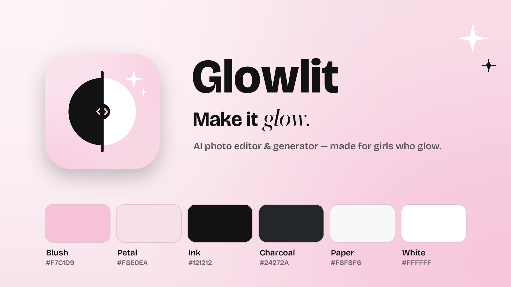

**Glowlit** is an iPhone and iPad app, also built for the Mac with Mac Catalyst, for AI photo editing and AI image generation, with free on-device effects and video editing, **made for girls who glow**.

> Working on this repository with an AI agent (or new to it)? Start with [AGENTS.md](AGENTS.md): what the app is, where the code lives, how to build and test, the rules and what's next.

- **Say it, see it:** "give me pink hair", "add soft glam makeup", "put me in a pink dress". "Ideas for this photo" suggests effects, looks and edits that fit the picture (worked out on the device), and **Surprise me** tries free effects for you.
- **One-tap looks:** 50+ trends such as Doll Box, Y2K Digicam, Bow Era, Sticker Sheet, Plushie Me, Fairy Princess, bestie looks like Sleepover and pet portraits, plus seasonal looks (Halloween, winter, Galentine's) promoted on Home in season.
- **Dream it, create it:** turn any idea into art with 20 styles, from Pastel Dream and Kawaii to Watercolor, Sticker and Cozy Knit. With Apple Intelligence, **Inspire me** and **Make it magic** write ideas and better prompts on the device, and **Create with Image Playground** makes pictures with Apple's own image maker on supported devices. New results "develop" like an instant photo.
- **Retro effects:** free on-device effects from the 80s to the 2010s (VHS '86, Disposable '98, Kira Kira, Digicam '04, Instant '82, Glamour '92, Neon '84, Throwback '16, Camcorder '06 and Film Still) with an optional date stamp, border, letterbox or camcorder display, one-tap **Auto** for light and colour, and RAW photos developed automatically with the best settings.
- **Simple video editing:** auto-cut the silences (a jump cut), add a retro effect, trim, then save to Photos or share. Free and on-device, with no watermark and no ending clip, for clips up to 5 minutes.
- **Made to share:** one tap to Instagram Stories, a "Cover star" magazine cover, a photo-booth "Photo strip", before/after collages, 9:16 story cards and caption ideas about the vibe (never about looks), plus a "Glow together" invite card with a QR code.
- **Free on your device:** effects, video editing, adjustments, **Crop** (posting shapes, rotate, mirror, straighten), **Cut out** (tap to pick the subject, then a colour, gradient, blurred or photo background, or an outlined sticker), **Hide faces** (blur, pixelate or cover other people's faces before sharing) and Best shot all run on-device, with no watermark.
- **Lives on your Home Screen:** "Today's trend" and "My glow" widgets, plus a Live Activity in the Dynamic Island and on the Lock Screen while the AI works.
- **Things other apps don't do:** an on-device **likeness check** after every people edit, **Best shot** (finds the selfie with the best light and focus, never by looks), **Which vibe?** ("A or B?" cards with two of your creations for friends, never your photo against an edit), a **kindness reminder** with a one-tap "Hide their faces" when friends are in the photo, a small **Feel good** page, and an optional visible **AI-edited** label that, like the hidden AI metadata, stays with a picture through every re-edit. See [the audit](docs/07-audit-and-differentiators.md).
- **Speaks your language, on iPhone and iPad:** 12 languages, a universal layout with adaptive grids and readable widths, and the iOS 26 Liquid Glass tab bar and editor toolbar (with a frosted fallback on iOS 17–18).
- **On the Mac too:** the same app on macOS 14+ (Mac Catalyst), with a menu bar (⌘N New Creation, ⌘O Open Photo…, ⌘1–⌘4 for the tabs, ⌘, Settings), drag and drop of photo files, Esc and ⌘S in the editors, and a resizable window. One purchase covers iPhone, iPad and Mac. The Live Activity and Instagram Stories sharing are iPhone and iPad only.
- **Easy to find your way:** a 7-step guided tour after onboarding spotlights Magic Edit, the daily credits, the free tools, Create, photos and videos, the private gallery and Settings. Replay it from Settings → "Show me around".
- **Safe by design:** the prompt filter blocks sexual, revealing, humiliating and body- or face-reshaping requests in every app language, and every edit keeps her face, body, skin tone and skin texture. A neutral age step comes first: under 13 gets the on-device tools only, and under 18 never sees a paywall by itself.
- **Optional account:** none is created until the first cloud edit or purchase; Sign in with Apple keeps Pro and credits on every device. No sign-up wall, and Delete my data removes everything.

| Promise | What it means |
|---|---|
| **Likeness Lock** | Every look keeps the face, skin tone and body as they are, plus *"Doesn't look like you? Retry free."* No body-reshaping or skin-lightening features. |
| **Fair-Price Promise** | No weekly plan, ever. Pro Yearly $39.99 with a 7-day free trial (≈ $3.33/month) or Pro Monthly $5.99 (first month $1.99 if eligible), credit packs that never expire (30 for $2.99, 100 for $7.99), rollover credits, exact refunds when a generation fails, and a reminder before the trial bills. |
| **Private by default** | Explicit consent before any cloud AI, high-privacy defaults designed with teens in mind, photos never used to train AI, and results cleared from our servers as soon as the app has them (within an hour at most). |
| **Server-side trend recipes** | Template prompts live on the server, so looks can be tuned without an app update. New looks ship with app updates; a remote catalog is on the roadmap. |

> 🇹🇷 Türkçe özet: [docs/00-ozet-TR.md](docs/00-ozet-TR.md)

## Screenshots

<table>
  <tr>
    <td align="center">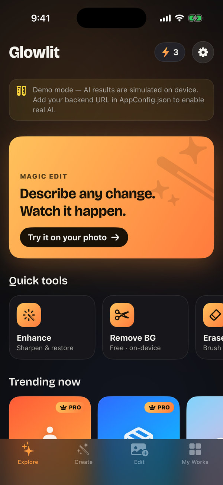<br><sub>Explore</sub></td>
    <td align="center">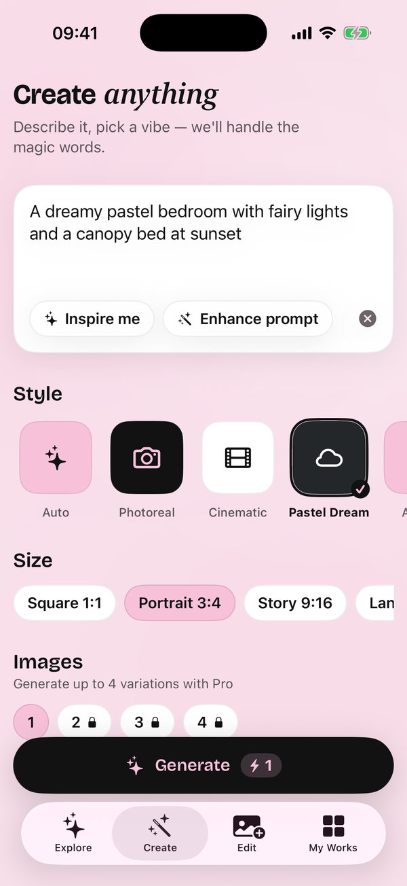<br><sub>Create from text</sub></td>
    <td align="center">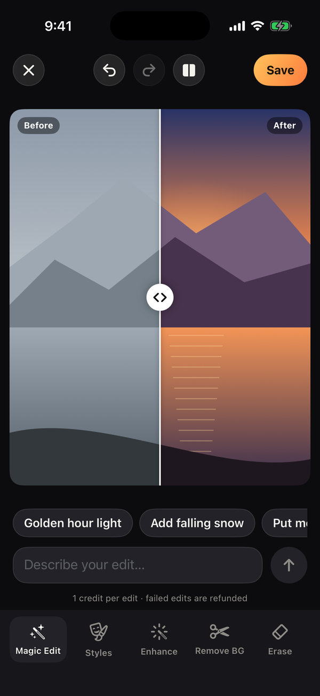<br><sub>Before / after</sub></td>
    <td align="center">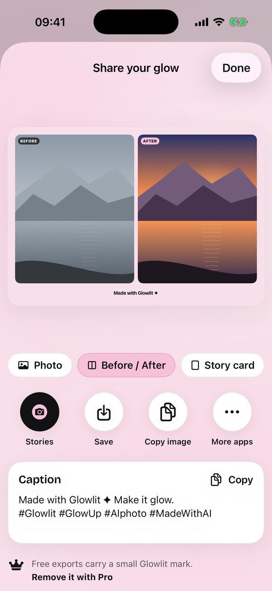<br><sub>Share your glow</sub></td>
  </tr>
  <tr>
    <td align="center">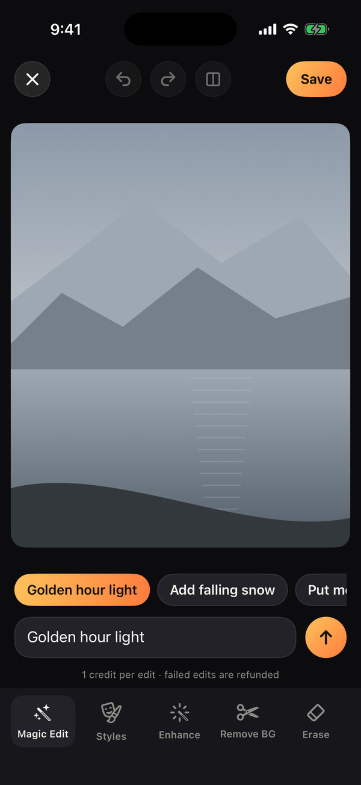<br><sub>Magic Edit</sub></td>
    <td align="center">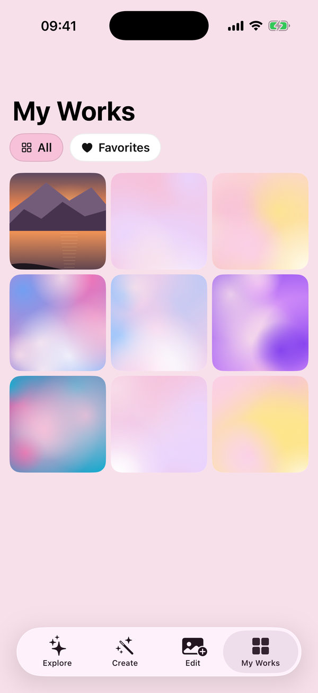<br><sub>My Works</sub></td>
    <td align="center">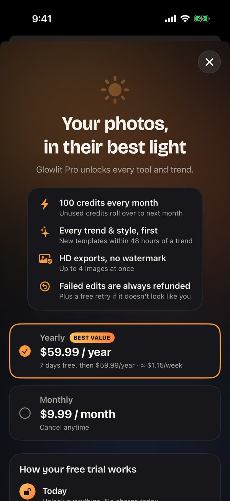<br><sub>Paywall</sub></td>
    <td align="center">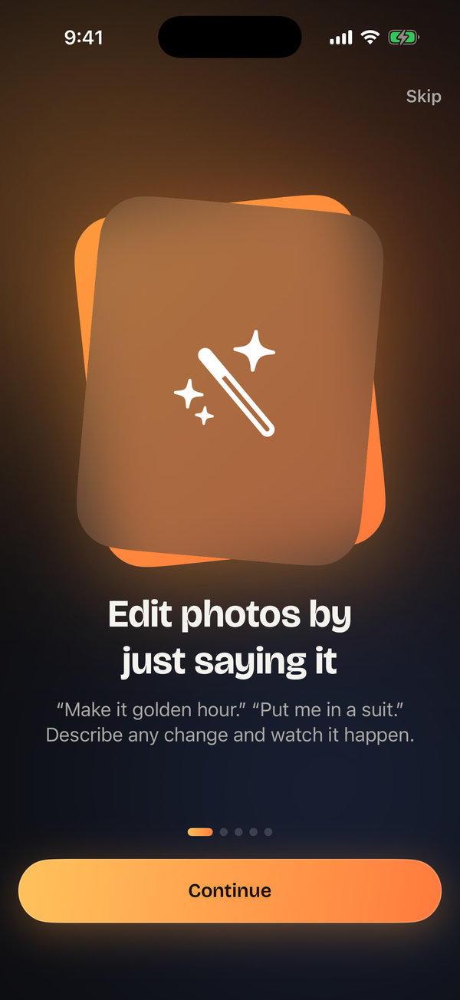<br><sub>Onboarding</sub></td>
  </tr>
  <tr>
    <td align="center">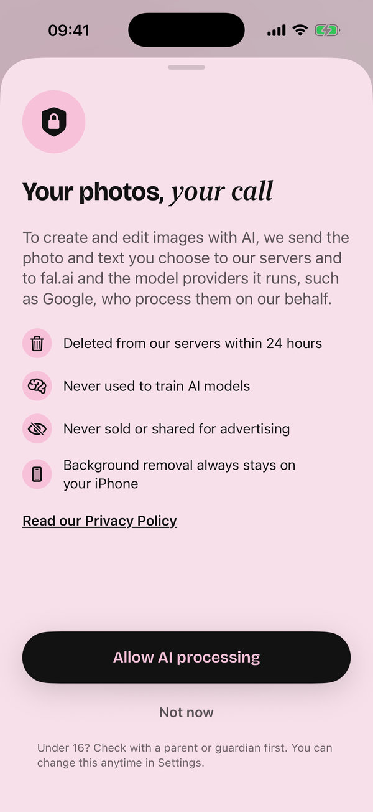<br><sub>AI consent</sub></td>
    <td align="center">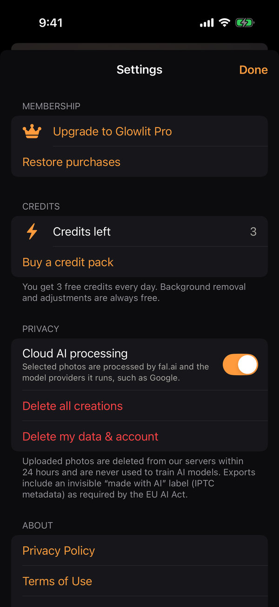<br><sub>Settings</sub></td>
    <td align="center">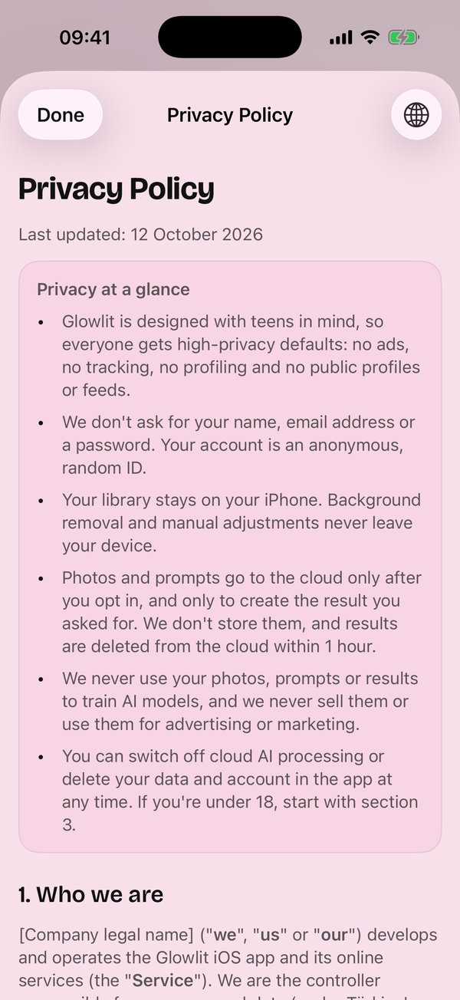<br><sub>Privacy Policy</sub></td>
    <td align="center">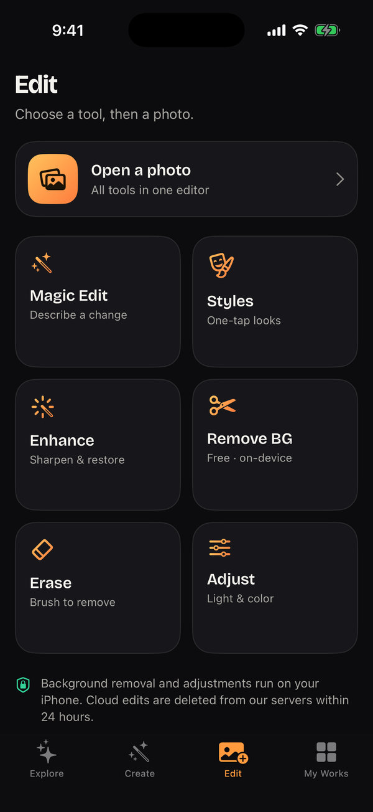<br><sub>Edit hub</sub></td>
  </tr>
</table>

Captured on an iPhone simulator in demo mode (AI results are simulated). The [Screenshots workflow](.github/workflows/screenshots.yml) refreshes the full-resolution set on the [`screenshots` branch](https://github.com/RiosenBeq/aybuke-app/tree/screenshots); `scripts/screenshot-gallery.py` rebuilds this gallery.

## Quick start

**Requirements:** Xcode 16 or newer (Xcode 26 for the iOS 26 Liquid Glass look; older SDKs build a frosted fallback) and an iOS 17+ iPhone or iPad, simulator or device. For the Mac app, pick the **My Mac (Mac Catalyst)** destination (macOS 14+); [AGENTS.md](AGENTS.md#3-build-run-test) explains running it without an Apple account.

1. Open `ios/Glowlit.xcodeproj` and run the **Glowlit** scheme. Xcode resolves the RevenueCat Swift package on first open.
2. With no AI key or backend configured, the app runs in **demo mode**: every screen works offline and AI results are simulated on-device and stamped "DEMO PREVIEW".
3. Subscriptions are testable locally: the scheme uses `ios/StoreKit/Products.storekit`.

## Connect an AI provider

There are two places for an AI key. Neither is ever committed to git.

**1. Try it in the simulator (developer mode, DEBUG builds only)**

1. Copy `ios/Config/Secrets.example.xcconfig` to `ios/Config/Secrets.xcconfig` (git-ignored; an empty one already exists on the development Mac).
2. Fill in `GL_AI_PROVIDER` (`xai`, `fal`, `openai` or `gemini`) and `GL_AI_API_KEY`. Model overrides are optional.
3. Run the app. Explore shows "Developer mode", and Magic Edit, Styles, Enhance, Erase and Create use the provider directly. Credits stay local.

Release builds never contain the key, because `Release.xcconfig` blanks it and the code only reads it in DEBUG. Use a paid API tier: some free tiers may use your requests to improve their models, which would break the app's privacy promise.

**2. Production (backend)**

Deploy the Supabase backend ([backend/README.md](backend/README.md)) and set `XAI_API_KEY` as an Edge Function secret (or `FAL_KEY` with `AI_PROVIDER=fal`). Then set `backendBaseURL` and `supabaseAnonKey` in `ios/App/Resources/AppConfig.json`. The backend meters credits, moderates prompts and outputs, and keeps the provider key off devices.

Cloud jobs run on xAI Grok Imagine (`grok-imagine-image-2.0` at 1k): low quality for free users and medium for Pro, about $0.04 per created image and $0.05–0.07 per edit. Each request runs in the background (`EdgeRuntime.waitUntil`); results come back inline and are cleared as soon as the app confirms the download, and `sweep_jobs()` clears any left after an hour. **Before launch, switch on Zero Data Retention in the xAI console:** selfies are personal data. xAI doesn't train on API data without permission. fal.ai stays available as an alternative.

> 🇹🇷 **API anahtarı nereye?** Simülatörde denemek için `ios/Config/Secrets.xcconfig` dosyasına `GL_AI_PROVIDER` (xai, fal, openai veya gemini) ve `GL_AI_API_KEY` değerlerini yazın. Canlı sürüm için anahtar yalnızca backend'de `XAI_API_KEY` olarak durur (fal.ai için `FAL_KEY` ve `AI_PROVIDER=fal`). Lansmandan önce xAI konsolunda Zero Data Retention'ı açın. Bu dosyalar git'e girmez.

## Sharing and promotion

- **In the app:** the share composer (`ios/App/Features/Share/`, designs in `ios/App/Services/Sharing/ShareDesigns.swift` and `ShareRenderer.swift`) exports a photo, a before/after collage, a 9:16 story card, a "Cover star" 4:5 magazine cover (the masthead tucks behind her head, using on-device Vision person segmentation), a date-stamped photo-booth "Photo strip" or a "Which vibe?" card (two variations of one creation). Free exports carry a small "Made with Glowlit" mark, which Pro removes. Every AI export keeps the IPTC "made with AI" metadata. The composer offers caption ideas written on the device, with hashtags (the AI ones only for AI content). **Stories** works without a Meta App ID: the system share sheet opens with just the image and a hint ("Tap Instagram, then Stories"), and the caption goes to the clipboard. With `instagramAppID` (a Meta App ID) set in `AppConfig.json`, it opens Instagram Stories directly.
- **Invite card:** "Glow together" (`InviteView`, from Settings and Home) makes a 9:16 story card with the app icon and a QR code that links to the App Store page, or to `websiteURL` until there is one. It's made from brand art only and never includes the user's photos.
- **Marketing kit:** [docs/marketing/](docs/marketing/README.md) contains App Store copy (EN/TR) with measured character counts, a social media kit, a 30-day launch plan, generated App Store screenshots and social images.
- **Website:** [web/](web/README.md) is a static landing page with the legal pages, ready for GitHub Pages (`.github/workflows/website.yml`).

## Notifications, ratings and accounts

- **Notifications** are local and opt-in (`GlowNotifier`, `NotificationPlanner` in AppCore): edit ready, free credits back, one free look a week, and the trial reminder (at least 26 hours before the trial ends). Never at night (21:00–09:00) or during school hours on weekdays, and never her prompt on the Lock Screen (Live Activity and widget titles are catalog names).
- **Rating prompts** follow `ReviewPromptPolicy`: only after the third save, share or heart, from day 3, once per version, never after a failure, report, retry or paywall.
- **Accounts** are optional: Sign in with Apple, then the backend merges the anonymous user (see [backend/README.md](backend/README.md#accounts-sign-in-with-apple)). Turn on the Sign in with Apple capability for `app.glowlit.ios` before running on a device.

## Widgets and Live Activity

- **Widgets** (`ios/GlowlitWidgets/`): *Today's trend* (small, medium and Lock Screen) picks one look per day and opens it in one tap. *My glow* (small, medium and Lock Screen) shows the newest creation, the credits left and shortcuts to Magic Edit, Create and Cut out.
- **Live Activity:** cloud jobs show progress in the Dynamic Island and on the Lock Screen ("Creating your glow…" → "Adding the final sparkle…" → "Your glow-up is ready"). The bar animates on its own, so it keeps moving while the app is in the background.
- **Plumbing:** the app writes a small snapshot and a 600 px thumbnail to the App Group `group.app.glowlit.shared` (`GlowWidgetBridge`). Taps open `glowlit://` deep links (`GlowDeepLink` in AppCore).
- **Signing:** before running on a device, enable the App Groups capability for both `app.glowlit.ios` and `app.glowlit.ios.widgets` in your developer account and add `group.app.glowlit.shared`. The simulator works as is.

## Languages

The app speaks 12 languages: English, Turkish, Spanish, Brazilian Portuguese, French, German, Italian, Russian, Japanese, Korean, Simplified Chinese and Indonesian. It follows the iPhone's language. Settings → **Language** opens iOS Settings, where Glowlit can have a language of its own; on the Mac it opens System Settings → Language & Region, where Glowlit can be added under Applications. The legal documents are in English and Turkish only; every other language shows the English versions.

**Add or change a string**
- **App and widget text:** write it in English in SwiftUI (`Text("…")`, `String(localized:)`). Xcode adds it to a String Catalog when you build: `ios/App/Resources/Localizable.xcstrings` (app), `ios/GlowlitWidgets/Localizable.xcstrings` (widgets) or `ios/App/Resources/InfoPlist.xcstrings` (permission prompts and other Info.plist text). Translate it in Xcode's catalog editor.
- **AppCore text** (look and style names, error and content-policy messages, prompt ideas) stays plain English, because AppCore builds and tests on Linux. The app shows it through `L10n.core(_:)`. After changing it, run `python3 scripts/export-core-strings.py`: it regenerates `CoreStrings.swift` for the app and the widgets, so the English keys reach the catalogs. CI runs it with `--check`.
- **Translators:** export and import XLIFF (`.xcloc`) with Xcode:
  ```bash
  xcodebuild -exportLocalizations -project ios/Glowlit.xcodeproj -localizationPath build/loc -exportLanguage de -exportLanguage ja
  xcodebuild -importLocalizations -project ios/Glowlit.xcodeproj -localizationPath build/loc/de.xcloc
  ```

**Add a language:** in Xcode, select the project → Info → Localizations → **+**, then translate the three catalogs (or export, translate and import as above). Add the language's sexual-content terms to `ContentPolicy.swift` (AppCore, with a test) and to `backend/supabase/functions/_shared/policy.ts`, so the prompt policy keeps covering every app language. Localize the App Store listing too.

## Subscription analytics (RevenueCat)

RevenueCat runs in **observer mode** (`ios/App/Services/Store/RevenueCatBridge.swift`): StoreKit 2 and our backend still sell, verify and grant everything, and RevenueCat only records each purchase for its dashboard (revenue, trials, churn, refunds). Customers are identified by our account ID (anonymous or Apple). RevenueCat never receives photos, prompts or results, and it's listed as a sub-processor in the Privacy Policy.

It's on in builds: the project's **public** Apple SDK key (`appl_…`) is set as `revenueCatAPIKey` in `ios/App/Resources/AppConfig.json`. An empty key turns RevenueCat off. Setup, for reference:
1. In RevenueCat, the project has an App Store app for `app.glowlit.ios`; its public SDK key goes in `revenueCatAPIKey`. Public SDK keys are safe to ship; never put a secret (`sk_…`) key in the app.
2. **The owner** generates an in-app purchase key in App Store Connect (Users and Access → Integrations → In-App Purchase) and uploads the `.p8` file, with its Key ID and Issuer ID, in RevenueCat's app settings, so RevenueCat can read StoreKit 2 transactions. Keep the `.p8` out of the repository.

## Legal

Terms of Use, Privacy Policy, Acceptable Use & AI Content Policy (English and Turkish) and the KVKK Aydınlatma Metni are in [legal/](legal/README.md). `scripts/build-legal.py` renders them into the app (shown natively in Settings, onboarding, the paywall and the consent screen), to [docs/legal/](docs/legal/) and to `web/legal/`. **They are drafts for legal review.** Fill in `legal/config.json` and follow the checklist in `legal/README.md` before publishing.

## Repository

```
ios/        SwiftUI app (Glowlit.xcodeproj) + AppCore Swift package (business logic, 100 tests)
  GlowlitWidgets/  WidgetKit extension: Home and Lock Screen widgets, Dynamic Island Live Activity
  Config/   Info.plist additions and xcconfigs (developer AI key slot: Secrets.xcconfig)
backend/    Supabase: Postgres schema, credit ledger and reports; Edge Functions (xAI and fal.ai, Apple JWS, accounts, reports); SQL tests
legal/      Source texts of the legal documents (EN/TR) and their config
docs/       Research, brand, product spec, architecture, compliance, roadmap, marketing kit, published legal copies
web/        Static landing page and legal pages
scripts/    Tooling: catalog export, core strings for translation, legal build, brand assets, marketing images, README gallery
.github/    CI (AppCore, Deno, SQL, legal and core-strings sync, Xcode), simulator screenshots, website deploy
```

## Stack

| Layer | Technology |
|---|---|
| iOS app | SwiftUI · Observation · SwiftData · StoreKit 2 · Vision · Core Image · AVFoundation · PhotosUI · WidgetKit · ActivityKit · String Catalogs (12 languages) · RevenueCat (observer mode) · iOS 17+, iPhone and iPad, Mac Catalyst (macOS 14+), Liquid Glass on iOS 26 |
| Design | "Blush" palette (blush `#F7C1D9`, petal `#F8E0EA`, ink `#121212`) for text and controls · "Aura" accents (pink `#FF5CA1`, lilac `#A78BFA`, peach `#FFAA78`, butter `#FFDE6E`, mint `#78E1CD`) for the app icon, share cards and template art · Poppins (OFL) with New York Italic accents · light-first, with Dark and Automatic appearances |
| AI | Backend: xAI Grok Imagine (`grok-imagine-image-2.0`), or fal.ai (Nano Banana 2, SeedVR2, object removal) with `AI_PROVIDER=fal`. Developer mode: xAI, fal.ai, OpenAI Images or Google Gemini directly |
| Backend | Supabase (anonymous Auth, Postgres with RLS, Edge Functions/Deno) · Apple App Store Server Library |
| Quality | XCTest (Linux and macOS) · `deno check`/`lint`/`fmt` · PostgreSQL ledger and report tests · legal and core-strings sync checks · `xcodebuild` |

## Running the checks locally

```bash
swift test --package-path ios/Packages/AppCore                 # business logic (works on Linux too)
backend/scripts/test-db.sh                                     # migrations + ledger and report tests (PostgreSQL 14+)
python3 scripts/build-legal.py --check                         # legal copies match legal/
python3 scripts/export-core-strings.py --check                 # AppCore strings registered for translation
cd backend/supabase/functions && deno check ai-image/index.ts  # Edge Functions
```

## Docs

Start with [docs/README.md](docs/README.md). Highlights:
- [Market research](docs/01-market-research.md)
- [Brand identity](docs/02-brand-identity.md)
- [Product spec](docs/03-product-spec.md)
- [Architecture](docs/04-architecture.md)
- [Compliance](docs/05-compliance.md)
- [Roadmap](docs/06-roadmap.md)
- [Audit: girl-first details and differentiators](docs/07-audit-and-differentiators.md)
- [Marketing kit](docs/marketing/README.md)

## Licences

- Code: all rights reserved by the repository owner unless stated otherwise.
- Poppins: SIL Open Font License 1.1 (`ios/App/Resources/Fonts/Poppins-OFL.txt`).
- RevenueCat SDK (`purchases-ios-spm`, via Swift Package Manager): MIT License.
