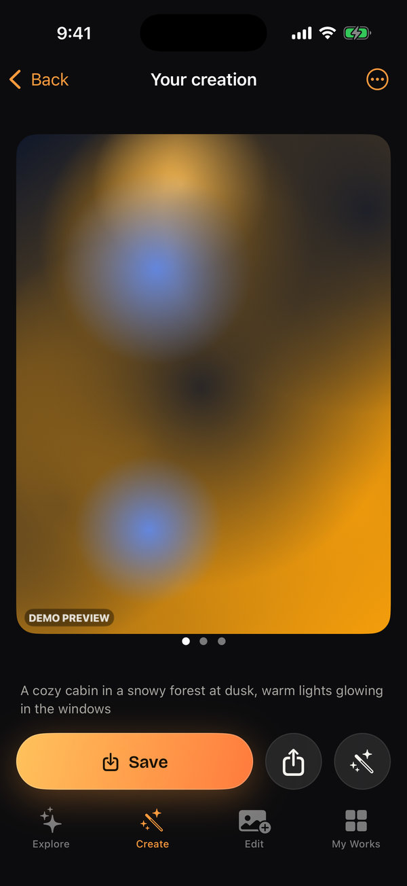

# Glowlit — AI Photo Editor & Generator for iOS


**Glowlit** is an English-language iOS app for AI photo editing and AI image generation.
- **Edit by describing it:** "make it golden hour", "put me in a suit".
- **Restyle in one tap:** 3D figurine, pro headshot, anime film, restore old photo…
- **Remove backgrounds and objects.**
- **Create anything from text.**

The app is built on research into the market's most popular apps. It differentiates on likeness, honest pricing and privacy:

| Promise | What it means |
|---|---|
| **Likeness Lock** | Identity-preserving templates, plus *"Doesn't look like you? Retry free."* |
| **Fair-Price Promise** | No weekly plan. Annual (7-day trial) or monthly plans, credit packs that never expire, rollover credits, exact refunds when a generation fails, and a reminder before the trial bills. |
| **Private by default** | Explicit consent before any cloud AI. Background removal and adjustments run on-device. Photos are never stored, and outputs expire after 1 hour. |
| **48-hour trend engine** | Template recipes live on the server, so new trends ship without an app update. |

> 🇹🇷 Türkçe özet: [docs/00-ozet-TR.md](docs/00-ozet-TR.md)

## Screenshots

<table>
  <tr>
    <td align="center"><br><sub>Explore</sub></td>
    <td align="center"><br><sub>Create from text</sub></td>
    <td align="center"><br><sub>Results</sub></td>
    <td align="center"><br><sub>Edit hub</sub></td>
  </tr>
  <tr>
    <td align="center"><br><sub>Magic Edit</sub></td>
    <td align="center"><br><sub>Before / after</sub></td>
    <td align="center"><br><sub>My Works</sub></td>
    <td align="center"><br><sub>Paywall</sub></td>
  </tr>
  <tr>
    <td align="center"><br><sub>Onboarding</sub></td>
    <td align="center"><br><sub>AI consent</sub></td>
    <td align="center"><br><sub>Settings</sub></td>
    <td></td>
  </tr>
</table>

These were captured on an iPhone Pro simulator in demo mode by the [Screenshots workflow](.github/workflows/screenshots.yml). The newest full-resolution set is on the [`screenshots` branch](https://github.com/RiosenBeq/furkan/tree/screenshots). To refresh this gallery, run `scripts/screenshot-gallery.py`.

## Quick start

**Requirements:** Xcode 16 or newer, iOS 17+ simulator or device.

1. Open `ios/Glowlit.xcodeproj` and run the **Glowlit** scheme.
2. With no backend configured, the app runs in **demo mode**:
   - every screen works offline;
   - AI results are simulated on-device and stamped "DEMO PREVIEW".
3. Subscriptions are testable locally: the scheme uses `ios/StoreKit/Products.storekit`.
4. For real AI, deploy the backend ([backend/README.md](backend/README.md)), then set `backendBaseURL` and `supabaseAnonKey` in `ios/App/Resources/AppConfig.json`.

## Repository

```
ios/        SwiftUI app (Glowlit.xcodeproj) + AppCore Swift package (business logic, 48 tests)
backend/    Supabase: Postgres schema + credit ledger, Edge Functions (fal.ai, Apple JWS), tests
docs/       Research, brand, product spec, architecture, compliance, roadmap
scripts/    Tooling (template-catalog export for the backend, README screenshot gallery)
.github/    CI: AppCore tests · Deno checks · SQL ledger tests · Xcode build · simulator screenshots
```

## Stack

| Layer | Technology |
|---|---|
| iOS app | SwiftUI · Observation · SwiftData · StoreKit 2 · Vision · Core Image · PhotosUI · iOS 17+ |
| Design | Golden Hour palette · Bricolage Grotesque (OFL) + SF Pro · dark-first |
| Backend | Supabase (anonymous Auth, Postgres with RLS, Edge Functions/Deno) · fal.ai (Nano Banana 2, SeedVR2, BiRefNet, object removal) · Apple App Store Server Library |
| Quality | XCTest (Linux and macOS) · `deno check`/`lint`/`fmt` · PostgreSQL ledger tests · `xcodebuild` |

## Running the checks locally

```bash
swift test --package-path ios/Packages/AppCore                 # business logic (works on Linux too)
backend/scripts/test-db.sh                                     # migration + credit ledger tests (PostgreSQL 14+)
cd backend/supabase/functions && deno check ai-image/index.ts  # Edge Functions
```

## Docs

Start with [docs/README.md](docs/README.md). Highlights:
- [Market research](docs/01-market-research.md)
- [Brand identity](docs/02-brand-identity.md)
- [Product spec](docs/03-product-spec.md)
- [Architecture](docs/04-architecture.md)
- [Compliance](docs/05-compliance.md)
- [Roadmap](docs/06-roadmap.md)

## Licences

- Code: all rights reserved by the repository owner unless stated otherwise.
- Bricolage Grotesque: SIL Open Font License 1.1 (`ios/App/Resources/Fonts/BricolageGrotesque-OFL.txt`).
