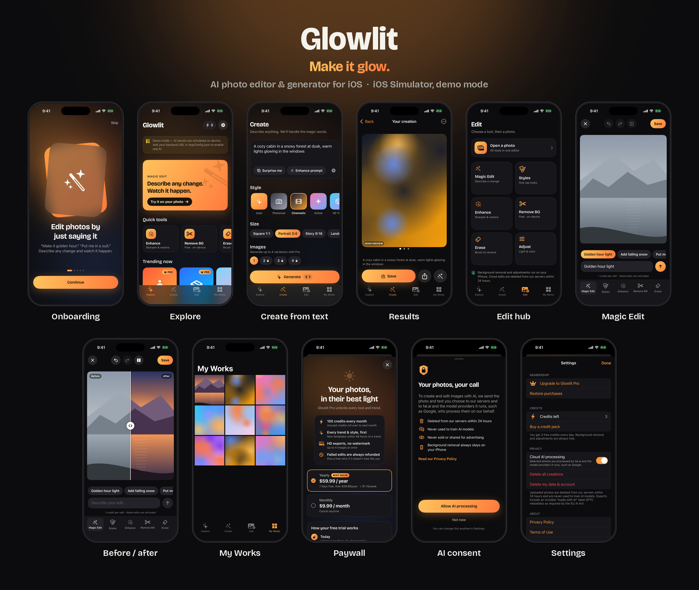

# Glowlit — Yönetici Özeti (Türkçe)

> Bu belge, araştırmayla alınan tüm kararların Türkçe özetidir. Ayrıntılar ve kaynaklar İngilizce belgelerdedir ([docs/README.md](README.md)).

## Ekim 2026 güncellemesi (2): video, retro efektler, xAI ve 12 dil

**Ne değişti?**
- **Video düzenleme (ücretsiz, cihazda):** Sessiz kısımları otomatik kesme ("jump cut"), retro efektler, kırpma, ardından Fotoğraflar'a kaydetme veya paylaşma. Filigran ve kapanış klibi yok; 5 dakikaya kadar klipler.
- **Retro efektler:** 80'lerden 2010'lara ücretsiz, cihaz içi efektler: VHS '86, Disposable '98, Kira Kira, Digicam '04, Instant '82, Glamour '92, Neon '84, Throwback '16, Camcorder '06 ve Film Still. Tarih damgası, çerçeve, sinema bantları ve kamera göstergesi isteğe bağlı; efektlerin sekizi videoda da çalışıyor (Camcorder '06 videoda işleyen zaman koduyla).
  - Adjust (ışık ve renk) aracında tek dokunuşla **Auto**: ışık ve renk otomatik ayarlanıyor.
  - RAW (ProRAW, DNG) fotoğraflar açılırken en iyi ayarlarla otomatik banyo ediliyor.
- **Yazı tipi:** Bricolage Grotesque'in yerini **Poppins** (SIL OFL) aldı; web sitesiyle aynı yazı tipi.
- **iOS 26 ve iPad:** Sekme çubuğu ve editörün araç çubuğu iOS 26'da Liquid Glass; iOS 17–18'de buzlu cam görünümüne geçiyor. Uygulama artık iPhone ve iPad için evrensel (uyumlu ızgaralar, okunabilir genişlikler).
- **Yeni fiyatlar:** Pro Yıllık $39.99 (7 gün ücretsiz deneme, ayda ≈ $3.33), Pro Aylık $5.99 (uygun kullanıcılara ilk ay $1.99), kredi paketleri 30 kredi $2.99 ve 100 kredi $7.99. Paywall'daki söz: çoğu AI fotoğraf uygulamasının yaklaşık yarı fiyatı, haftalık plan asla yok.
- **AI sağlayıcısı artık xAI Grok Imagine:**
  - Model `grok-imagine-image-2.0`, 1k çözünürlük: ücretsiz kullanıcılara düşük, Pro'ya orta kalite. Oluşturma başına yaklaşık $0.04, düzenleme başına $0.05–0.07; bulut işlemi başına ortalama ~$0.06.
  - fal.ai alternatif olarak duruyor (`AI_PROVIDER=fal`).
  - İstekler arka planda çalışıyor (`EdgeRuntime.waitUntil`). Sonuçlar yanıtın içinde (base64) geliyor ve uygulama indirdiğini onaylar onaylamaz siliniyor; kalanları `sweep_jobs()` bir saat sonra temizliyor.
  - xAI, izin verilmeden API verileriyle model eğitmiyor.
  - Pro'nun avantajı artık "en iyi kalitede AI, filigran yok" ("HD dışa aktarma" değil).
- **Yeni paylaşım biçimleri:**
  - "Cover star" dergi kapağı: dergi adı, cihaz içi Vision kişi ayırma sayesinde kişinin başının arkasına geçiyor.
  - "Photo strip": tarih damgalı fotoğraf kabini şeridi.
  - Instagram Hikâyeler artık Meta App ID olmadan da çalışıyor: sistem paylaşım sayfası yalnızca görselle açılıyor ve bir ipucu çıkıyor ("Tap Instagram, then Stories").
  - "Glow together" davet kartı: uygulama ikonu ve App Store sayfasına (o yokken web sitesine) giden QR kodlu 9:16 hikâye kartı. Ayarlar'dan ve Keşfet ekranından açılıyor; kullanıcının fotoğraflarını asla içermiyor.
- **Renkli "Aura" ikon:** Glow Print ikonunun renkli sürümü. Aura vurgu renkleri (pembe `#FF5CA1`, lila `#A78BFA`, şeftali `#FFAA78`, tereyağı sarısı `#FFDE6E`, nane `#78E1CD`) ikonda, paylaşım kartlarında ve çıkartma tarzı şablon görsellerinde kullanılıyor. Arayüz yazıları ve kontroller Blush paletinde kalıyor.
- **İlk açılış turu:** Onboarding'den sonra bir kez gösterilen 7 adımlı rehberli tur (Next / Skip): Magic Edit, günlük krediler, ücretsiz araçlar, Create, fotoğraf ve videolar, özel galeri, Ayarlar. Ayarlar → "Show me around" ile tekrar izlenebiliyor.
- **12 dil:** İngilizce, Türkçe, İspanyolca, Brezilya Portekizcesi, Fransızca, Almanca, İtalyanca, Rusça, Japonca, Korece, Basitleştirilmiş Çince ve Endonezce (String Catalog'lar).
  - Uygulama iPhone'un dilini kullanıyor. Ayarlar'daki "Language" satırı, uygulamaya özel dil seçimi için iOS Ayarları'nı açıyor.
  - AppCore metinleri çalışma anında `L10n.core` ile çevriliyor; `scripts/export-core-strings.py` bu metinleri çevirmenler için kaydediyor (CI'da `--check` ile).
  - Yasal metinler yalnızca İngilizce ve Türkçe.
  - İçerik politikası cinsel içerikli istekleri 12 dilin hepsinde engelliyor.
- **RevenueCat (gözlemci modunda):** Abonelik analizi için. Satışı ve doğrulamayı yine StoreKit 2 ve backend yapıyor; RevenueCat yalnızca satın almaları kaydediyor. Herkese açık SDK anahtarı ("appl_…") `AppConfig.json` dosyasındaki `revenueCatAPIKey` alanına girildi, yani derlemelerde açık (anahtar boş bırakılırsa kapanır). Gizlilik politikasında alt işleyen olarak yer alıyor.

**Sizin yapmanız gerekenler:**
- Lansmandan önce xAI konsolunda **Zero Data Retention**'ı açın (selfie'ler kişisel veridir) ve `XAI_API_KEY` değerini Supabase Edge Function gizli anahtarı olarak girin.
- RevenueCat projesi hazır ve herkese açık anahtar girildi. App Store Connect'te bir uygulama içi satın alma anahtarı (.p8) oluşturup RevenueCat'e siz yükleyin; bu dosya depoya girmemeli.
- App Store Connect'te yeni fiyatları ve aylık planın ilk ay $1.99 teklifini tanımlayın.

## Ekim 2026 güncellemesi: kızlara özel pembe Glowlit

**Ne değişti?**
- **Hedef kitle:** Glowlit artık kızlar ve genç kadınlar için tasarlandı ("made for girls who glow").
- **Renkler:** Talep üzerine tamamen pembe, açık tonlu "Blush" paleti kullanılıyor: blush `#F7C1D9`, petal `#F8E0EA`, ink `#121212`, antrasit `#24272A`, kırık beyaz `#F8F8F6` ve beyaz. Ana butonlar siyah üzerine pembe yazı. Ayarlar'dan Açık (varsayılan), Koyu veya Otomatik görünüm seçilebiliyor.
- **Tasarım detayları:** Başlıklarda zarif italik serif vurgular ("Watch it *glow.*"), kalp ve parıltı motifleri, başarı anında parıltı animasyonu, gölgeli beyaz kartlar. Uygulama ikonunun (artık renkli "Aura" sürümü) koyu ve renklendirilmiş varyantları da var.
- **Yeni şablonlar:** Yıl boyu 36 görünüm, ayrıca mevsimlik görünümler (Cadılar Bayramı, kış, Galentine's; Ana sayfada yalnızca mevsiminde öne çıkar, düzenleyicide her zaman vardır). Örneğin Doll Box, Pembe Saç, Soft Glam, Bouncy Curls, Clean Girl, Ballet Core, Kiraz Çiçeği, Kafe Buluşması, Paris Gezisi, Peri Prensesi, Doğum Günü Glam ve Witchy Glam. 14 stil var (Pastel Dream ve Kawaii eklendi).
  - Tüm şablonlar yüzü, ten rengini ve **vücut şeklini** korur.
  - Vücut inceltme veya cilt açma gibi özellikler bilinçli olarak yok.
- **Paylaşım (tanıtım için):** Yeni Paylaş ekranından Instagram Hikâyeler, Önce/Sonra kolajı, 9:16 hikâye kartı, görsel kopyalama, hazır açıklama ve hashtag'ler kullanılabiliyor. Bulut yapay zekâ sonuçlarının ücretsiz paylaşımlarında küçük "Made with Glowlit" işareti var (Pro'da ve yalnızca cihaz içi araçlarla yapılan düzenlemelerde yok). Yapay zekâ ile yapılan her dosyada görünmez "yapay zekâ ile yapıldı" etiketi korunuyor, yeniden düzenlemeden sonra da; #AIphoto #MadeWithAI hashtag'leri ve bu not yalnızca o zaman çıkıyor.
- **Animasyonlar ve süslemeler:** Kartlar sırayla belirir, butonlar dokununca yaylanır. Kalp ve parıltılar yanıp söner, ana karttan ışık geçer. Beklerken kalpler ve yıldızlar ışığın etrafında döner. Önce/sonra kaydırıcısı kendini kısaca gösterir, kredi sayısı animasyonla değişir. "Hareketi azalt" açıksa animasyonlar kapanır.
- **Widget'lar ve Dynamic Island:**
  - "Günün trendi" ve "My glow" widget'ları (ana ekran ve kilit ekranı). My glow son görseli, kalan krediyi ve Magic / Create / Cut out kısayollarını gösterir.
  - AI çalışırken Dynamic Island'da pembe parıltı ve ilerleme halkası görünür; kilit ekranında da ilerleme kartı vardır ("Creating your glow…" → "Your glow-up is ready").
  - Gerçek cihazda çalıştırmak için geliştirici hesabında `group.app.glowlit.shared` App Group'unu iki paket kimliğine de eklemek gerekir.
- **Denetim ve rakiplerde olmayanlar (Ekim 2026, ayrıntı: [07](07-audit-and-differentiators.md)):** Kullanıcı yorumları ve 20 rakip uygulama incelendi. Önce tasarım, sonra teknik, sonra özellikler eklendi; gereksiz bulunanlar çıkarıldı.
  - *Tasarım:*
    - Kategori kartları keskin köşeli; "See all" ile dergi tarzı, numaralı koleksiyon sayfaları açılıyor.
    - Galeride çift dokunarak kalp bırakılabiliyor.
  - *Teknik:*
    - İsteğe bağlı bildirimler (hazır olunca, krediler gelince, haftada bir görünüm). Gece 21:00–09:00 arasında ve hafta içi okul saatlerinde gönderilmez.
    - Değerlendirme yalnızca mutlu anlarda isteniyor.
    - Uygulamadaki "24 saatte silinir" yazısı, politikadaki "1 saat" ile eşitlendi.
  - *Özellik (rakiplerde yok):*
    - Benzerlik kontrolü ("Still you" / cilt tonu değiştiyse ücretsiz tekrar).
    - Best shot (selfie'leri ışık ve netliğe göre sıralar, asla görünüşe göre değil).
    - Help me pick (A mı B mi kartı).
    - Arkadaş yüzü varsa nezaket hatırlatması ("Only edit me").
    - İsteğe bağlı görünür "AI-edited" etiketi.
  - *Çıkarılanlar:*
    - Rakiplerde zaten olduğu için: "Steal the look", feed önizlemesi ve fotoğraf dökümü.
    - Doğum günü, doğum tarihi gerektirdiği için.
- **Apple ile giriş (isteğe bağlı):** Premium üyelik ve krediler başka iPhone'da da kullanılabiliyor. Anonim hesap otomatik olarak Apple hesabına birleştiriliyor, hesap silinince Apple erişimi iptal ediliyor. Fotoğraflar eşitlenmiyor, her iPhone'da kalıyor. Gerçek cihazda çalışması için Apple Developer hesabında "Sign in with Apple" özelliğinin ve Supabase'de Apple sağlayıcısının açılması gerekiyor.
- **Diğer yeni özellikler:** Galeride kalpli favoriler. "Bu görseli bildir" artık gerçekten backend'e gidiyor (`report` fonksiyonu ve `reports` tablosu).
- **Yasal metinler:** Kullanım Koşulları, Gizlilik Politikası, Kabul Edilebilir Kullanım Politikası (İngilizce ve Türkçe) ve KVKK Aydınlatma Metni hazırlandı. GDPR, KVKK (7499 sayılı Kanun değişiklikleri dahil), CCPA, COPPA, Birleşik Krallık Yaşa Uygun Tasarım Kuralları, AB Yapay Zekâ Tüzüğü md. 50 ve Apple'ın EULA şartları kapsanıyor.
  - Metinler uygulamanın içinde okunabiliyor ve ayrıca `docs/legal/` ile `web/legal/` altında yayınlanıyor.
  - **Bunlar avukat incelemesi gereken taslaklardır.** Şirket bilgilerini `legal/config.json` dosyasına girin ve `legal/README.md` kontrol listesini uygulayın.
- **AI API anahtarı yeri:**
  - **Denemek için:** `ios/Config/Secrets.xcconfig` dosyasına `GL_AI_PROVIDER` (xai, fal, openai veya gemini) ve `GL_AI_API_KEY` yazılır. Bu dosya git'e girmez ve yalnızca geliştirme derlemelerinde okunur.
  - **Canlı sürüm için:** Anahtar backend'de `XAI_API_KEY` olarak saklanır (fal.ai kullanılacaksa `FAL_KEY` ve `AI_PROVIDER=fal`).
- **Tanıtım kiti (`docs/marketing/`):** App Store metinleri (İngilizce ve Türkçe, karakter sayılı), sosyal medya kiti (biyografiler, hashtag'ler, 20 gönderi, 10 video senaryosu, influencer şablonları), 30 günlük lansman planı, 8'er App Store ekran görüntüsü ve sosyal medya görselleri.
- **Web sitesi (`web/`):** Tanıtım sayfası ve yasal sayfalar hazır. GitHub Pages ile yayınlanabilir (`.github/workflows/website.yml`).

**Sizin yapmanız gerekenler:** Yasal metinleri avukata inceletin ve şirket bilgilerini girin. AI API anahtarını iletin. İsterseniz Instagram Hikâyeler'e doğrudan paylaşım için bir Meta App ID alın (artık şart değil). `glowlit.app` alan adını ve marka tescilini kontrol edin.

## Ne yaptık?

Brief şuydu: AI ile fotoğraf düzenleme ve AI ile görsel oluşturma uygulaması yapılacak. Uygulama İngilizce olacak; piyasa, kullanıcı tercihleri, renk, yazı tipi ve isim araştırılacak; iş aşama aşama ilerleyecek; Swift kullanılacak.

Bu brief'i üç paralel araştırmayla (pazar, marka/tasarım, teknoloji/uyumluluk) somut bir ürüne dönüştürdük ve hepsini koda döktük:

1. **Araştırma:**
   - 15 rakip uygulama incelendi.
   - Kullanıcıların sevdiği ve nefret ettiği noktalar çıkarıldı.
   - 2025–2026 viral trendleri ve fiyatlandırma kıyasları (RevenueCat, Adapty) derlendi.
   - Renk haritası, yazı tipi ve isim çalışması yapıldı.
   - AI modelleri, maliyetler, App Store kuralları ve AB Yapay Zeka Yasası incelendi.
2. **Marka:** isim **Glowlit**, slogan *"Make it glow."*, pembe "Blush" paleti (Ekim 2026'dan beri; başlangıçta "Golden Hour" amberdi) ve renkli "Aura" vurguları, Poppins + New York Italic yazı tipleri (Ekim 2026'ya kadar Bricolage Grotesque), "Glow Print" ikonunun renkli "Aura" sürümü.
3. **iOS uygulaması (SwiftUI, iPhone ve iPad):**
   - Ekranlar: onboarding, rehberli tur, AI onayı, keşfet, metinden görsel oluşturma, editör (Magic Edit, stiller, efektler, iyileştirme, arka plan silme, nesne silme, ayarlar), video editörü, paylaşım, kütüphane, paywall, ayarlar.
   - 12 dil desteği.
   - Backend olmadan da tamamen çalışan **demo modu** var.
4. **Backend (Supabase + xAI; alternatif olarak fal.ai):**
   - Kimlik doğrulama, kredi defteri, Apple satın alma doğrulaması, güvenlik filtreleri ve asenkron AI iş kuyruğu.
5. **Testler ve CI:**
   - 100 Swift birim testi.
   - AppCore metinlerinin çeviri için kayıtlı olduğunun kontrolü (`export-core-strings.py --check`).
   - Deno tip kontrolü ve lint.
   - Gerçek PostgreSQL üzerinde kredi defteri testleri.
   - macOS'ta Xcode derlemesi ve simülatör ekran görüntüleri.

## Uygulamadan görüntüler

Görüntüler, CI'daki Screenshots iş akışında iPhone Pro simülatöründe demo modunda alındı. Ekranların tek tek hâlleri `assets/screenshots/` klasöründe; en güncel tam çözünürlüklü set ise `screenshots` dalında.

## Temel kararlar ve nedenleri

### İsim: Glowlit
- **Anlamı:** "Glow" kategorinin en duygusal sonuç kelimesi (glow-up, ışıl ışıl cilt, altın saat ışığı); "lit" ise ışıkla aydınlanmış demek, Z kuşağı argosunda da "harika" anlamına geliyor.
- **Neden diğer adaylar değil:** Araştırmadan çıkan Sunlit, Lumora, Pixora, Aglow gibi adayların `.app` ve `.ai` alan adları dolu, yani aktif kullanımdalar. **glowlit.app ve glowlit.ai ise boş.** Türetilmiş bir isim olduğu için marka tescili açısından da sözlük kelimelerinden daha güçlü.
- **Okunuş ve diller:** Duyulduğu gibi yazılıyor. İngilizce, İspanyolca, Portekizce, Fransızca, Almanca ve Türkçede olumsuz bir anlamı yok.
- **Mağaza başlığı:** `Glowlit: AI Photo Editor`.
- ⚠️ Lansmandan önce App Store, USPTO ve EUIPO marka taraması yapılmalı ve `glowlit.app` alınmalı.

### Renk: "Blush" (pembe, açık tema)
- **Ekim 2026'dan itibaren:** Talep üzerine uygulama tamamen pembe tonlarda. Arka plan petal `#F8E0EA`, kartlar beyaz, vurgu blush `#F7C1D9`, yazılar ink `#121212`.
- **Kontrast:** Pembe zeminde siyah yazı 15:1, siyah buton üzerinde pembe yazı 12:1. Pembe üzerine beyaz yazı **kullanılmaz** (1.6:1).
- **Kural:** Her ekranda tek bir ana aksiyon vardır: siyah, hap biçimli buton ve pembe yazı. Seçili öğeler pembe, fotoğrafların üzerine renk filtresi konmaz.
- **Önceki tercih:** Araştırmadaki "Golden Hour" amber ve koyu tema emekliye ayrıldı; gerekçeleri İngilizce belgede kayıtlı.
- **Aura vurguları:** Markanın renkli yüzü: pembe `#FF5CA1`, lila `#A78BFA`, şeftali `#FFAA78`, tereyağı sarısı `#FFDE6E`, nane `#78E1CD`. Yalnızca ikon, paylaşım kartları ve şablon görselleri gibi süslemelerde kullanılır; yazı ve kontroller her zaman Blush paletindedir.

### Yazı tipi: Poppins + SF Pro
- **Seçim:** Başlıklarda yuvarlak ve samimi formlara sahip geometrik bir sans olan Poppins (web sitesiyle aynı yazı tipi); gövde metinlerinde Apple'ın SF Pro'su (Dynamic Type desteği için). Vurgulu kelimeler New York Italic.
- **Lisans ve kesimler:** Lisansı SIL OFL, yani ücretsiz ve uygulamaya gömülebilir. Medium, SemiBold, Bold ve ExtraBold kesimleri uygulamada.
- **Önceki tercih:** Ekim 2026'ya kadar başlıklarda Bricolage Grotesque kullanılıyordu.
- **Elenenler:** Space Grotesk ve Sora sıradan "AI/web3" görünümü veriyor (Sora ayrıca OpenAI ile karışıyor); Unbounded kripto çağrışımı taşıyor.

### İkon: "Glow Print", renkli "Aura" sürümü (Ekim 2026)
Renkli bir "Aura" zemin (nane, lila, pembe, şeftali ve tereyağı sarısı bir ışıltı) üzerinde, bir mood board'a iğnelenmiş gibi hafif eğik, keskin köşeli beyaz bir baskı fotoğraf. İçinde koyu mor (plum) zemin üzerinde pembe parlayan beyaz bir ışıltı, fotoğrafın altında küçük pembe bir kalp var. Keskin baskı, uygulamadaki şablon kartlarıyla aynı dili konuşuyor; ışıltı "Make it glow." demek. Önceki "Sunrise Split" (önce/sonra diski) fazla teknik kaldığı için değiştirildi; ilk Glow Print pembe zeminliydi. Koyu ve renklendirilmiş varyantları da var; 29 pikselde de okunuyor.

### Fiyatlandırma: "Adil Fiyat Sözü"
Araştırmanın en net bulgusu: kullanıcıların **1 numaralı şikâyeti haftalık deneme tuzakları ve sürpriz ücretler**. Yıllık plan ise kurulum başına yaklaşık **5 kat** daha fazla gelir getiriyor; haftalık abonelerin bir yıl sonra yalnızca %1–2'si kalıyor.

| Plan | Fiyat | İçerik |
|---|---|---|
| Ücretsiz | 0 | Günde 3 kredi; cihaz içi araçlar (efektler, video düzenleme, arka plan silme, ayarlar, Best shot) sınırsız |
| **Pro Yıllık** (varsayılan) | **$39.99/yıl** (ayda ≈ $3.33), 7 gün ücretsiz deneme | Ayda 100 kredi (kullanılmayanlar 1 ay devreder, üst sınır 200), tüm şablonlar, en iyi kalitede AI, filigransız |
| Pro Aylık | $5.99/ay (uygun kullanıcılara ilk ay $1.99) | Aynı içerik |
| Kredi paketleri | 30 kredi $2.99 · 100 kredi $7.99 | **Süresiz** geçerli |

Güven özellikleri:
- **Haftalık plan asla yok.** Fiyatlar çoğu AI fotoğraf uygulamasının yaklaşık yarısı.
- Paywall'da deneme takvimi gösteriliyor ve deneme bitmeden 24 saat önce hatırlatma bildirimi geliyor.
- Başarısız işlerin kredisi **otomatik iade ediliyor**.
- Sahte geri sayım kullanılmıyor.

### Farklılaştırıcılar
1. **Likeness Lock:** İnsan içeren her şablonda yüz ve kimlik korunuyor. Sonuç kullanıcıya benzemezse "Bana benzemiyor mu? Ücretsiz tekrar dene" seçeneği var (en duygusal kalite şikâyetine çözüm).
2. **Sunucudaki trend tarifleri:** Şablon talimatları sunucuda duruyor; mevcut görünümler uygulama güncellemesi olmadan iyileştirilebiliyor. Yeni görünümler uygulama güncellemeleriyle geliyor; uzaktan katalog yol haritasında.
3. **Varsayılan olarak gizli:**
   - Bulut işlemesinden önce açık onay alınıyor (Apple 5.1.2(i)).
   - Arka plan silme, ayarlar, efektler ve video düzenleme cihaz içinde yapılıyor.
   - Yüklenen fotoğraflar saklanmıyor; çıktılar uygulama indirir indirmez, en geç 1 saatte siliniyor.
   - Dışa aktarılan her görsele AB Yapay Zeka Yasası için "AI ile üretildi" meta verisi (IPTC) ekleniyor.

## Mimari (kısaca)

- **iOS:**
  - SwiftUI, iOS 17+, iPhone ve iPad, @Observable, SwiftData, StoreKit 2; iOS 26'da Liquid Glass.
  - Arka plan silme Vision ile; ayarlar, Auto, efektler ve RAW banyosu Core Image ile; video düzenleme AVFoundation ile yapılıyor.
  - Metinler String Catalog'larda (12 dil). Abonelik analizi için RevenueCat gözlemci modunda.
  - İş mantığı Linux'ta da test edilebilen ayrı bir pakette (`AppCore`); sessizlik kesme (`SilenceCutter`) ve Auto (`AutoAdjust`) da orada.
- **Backend:**
  - Supabase: anonim oturum, Postgres kredi defteri (RLS), Edge Functions.
  - Varsayılan sağlayıcı xAI Grok Imagine: her işlem `grok-imagine-image-2.0` ile 1k çözünürlükte (ücretsizde düşük, Pro'da orta kalite). Arka plan silme her zaman cihazda.
  - Alternatif fal.ai modelleri (`AI_PROVIDER=fal`):
    - Metinden görsel ve düzenleme: Nano Banana 2
    - İyileştirme: SeedVR2
    - Nesne silme: object-removal
  - Uygulama yalnızca "işlem" adını gönderiyor; modeli sunucu seçiyor. Böylece model değiştirmek için uygulama güncellemesi gerekmiyor ve API anahtarı uygulamada hiç bulunmuyor.
- **Maliyet:**
  - xAI'da oluşturma başına yaklaşık $0.04, düzenleme başına $0.05–0.07; bulut işlemi başına ortalama yaklaşık $0.06.
  - Kredi kuralları SQL'de tanımlı, uygulama güncellemesi olmadan değiştirilebiliyor.

## Nasıl çalıştırılır?

1. Mac'te **Xcode 16 veya üzeri** ile `ios/Glowlit.xcodeproj` dosyasını açın ve bir iPhone veya iPad simülatörü seçip ▶︎ ile çalıştırın. Liquid Glass görünümü için Xcode 26 gerekir; eski sürümler buzlu cam görünümünü derler.
2. Backend tanımlı değilse uygulama **demo modunda** açılır. AI sonuçları cihazda simüle edilir ve "DEMO PREVIEW" etiketi taşır.
3. Gerçek AI için `backend/README.md` adımlarını izleyin:
   - Supabase projesi oluşturun ve `XAI_API_KEY` gizli anahtarını tanımlayın (fal.ai için `FAL_KEY` ve `AI_PROVIDER=fal`).
   - xAI konsolunda Zero Data Retention'ı açın.
   - Fonksiyonları deploy edin.
   - `AppConfig.json` dosyasına Supabase adresini ve anahtarını yazın.

## Sırada ne var? (bkz. [06-roadmap.md](06-roadmap.md))

1. İsmin hukuki kontrolü ve `glowlit.app` alan adının alınması.
2. Gizlilik politikası ve kullanım şartları sayfalarının yayınlanması.
3. xAI Zero Data Retention'ın açılması, Supabase'in kurulup deploy edilmesi ve TestFlight'ta uçtan uca test.
4. App Store Connect'te ürünlerin ve abonelik fiyatlarının tanımlanması ($39.99 yıllık, $5.99 aylık ve ilk ay $1.99 teklifi, $2.99 ve $7.99 paketler); uygulama içi satın alma anahtarının RevenueCat'e yüklenmesi.
5. App Attest ile ücretsiz kredi suistimaline karşı koruma; yaş doğrulama (Declared Age Range API).
6. Şablon kartlarına gerçek önce/sonra görsellerinin eklenmesi (farklı ten renkleri ve yüz tiplerinden oluşan geniş bir oyuncu kadrosuyla).
7. 11 çevirinin anadili konuşanlarca kontrolü; App Store metinlerinin ve ekran görüntülerinin bu dillere uyarlanması.
8. Büyüme aşaması: selfie profilli Likeness Lock v2, şablonların video versiyonları, C2PA içerik kimlik bilgileri.
