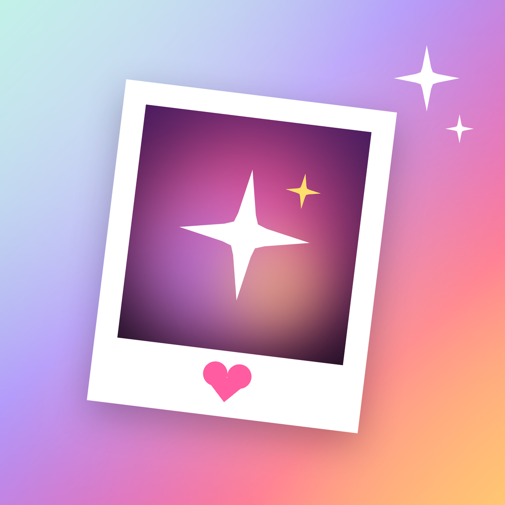

# 02 · Brand identity — Glowlit

| | |
|---|---|
| **Name** | **Glowlit** |
| **Tagline** | *Make it glow.* |
| **App Store title** | `Glowlit: AI Photo Editor` (24/30 characters) |
| **Subtitle (draft)** | `AI Headshots & Photo Trends` (27/30) |
| **Positioning** | The AI photo studio made for girls who glow: trend-ready, true-to-you photos, with honest pricing and private-by-default face data. |
| **Palette** | "Blush": blush pink `#F7C1D9` and petal `#F8E0EA` with ink `#121212`, charcoal `#24272A`, paper `#F8F8F6` and white; light-first. Decorative "Aura" accents (pink `#FF5CA1`, lilac `#A78BFA`, peach `#FFAA78`, butter `#FFDE6E`, mint `#78E1CD`) for the icon, share cards and template art only |
| **Display type** | Poppins (SIL OFL 1.1) + New York Italic accents + SF Pro |
| **Icon** | "Glow Print", Aura edition — a sharp-cornered white print, tilted on a colorful aura tile (mint, lilac, pink, peach), showing a sparkle glowing pink on plum, with a pink heart on its chin |

Full evidence: [research/brand-and-design.md](research/brand-and-design.md).

---

## 1. Name

### Brief

Research on the 21 leading apps ([research §4.1](research/brand-and-design.md#41-patterns-in-the-category)):
- The median brand token is 6 letters and 2 syllables.
- Winners are coined or real-word tokens, followed by a keyword title ("Brand: AI Photo Editor").

We wanted a name that:
- evokes **light** (photography's native metaphor) and the user outcome (a "glow-up");
- is spelled exactly as heard;
- is ownable;
- has no negative meaning in EN/ES/PT/FR/DE/TR.

### Screening

The research shortlist was Sunlit, Brilla, Lumora, Liora, Daylit, Aglow, Pixora and Glimmer. Web screening was impossible (search quota exhausted), so we screened by **domain availability**: a free `.app` **and** `.ai` is a strong signal that no tech product is actively using the name. We checked 69 domains on 2026-10-11 (read-only registry lookup).

| Candidate | `.app` | `.ai` | Other | Verdict |
|---|---|---|---|---|
| Sunlit | taken | taken | `sunlitapp.com` taken, `sunlit.co` taken | Crowded dictionary word |
| Brilla | taken | taken | `brillaapp.com` free | `.app`/`.ai` in use |
| Lumora | taken | taken | `lumoraapp.com` and `.photo` taken | Actively used; also "Lum-" cluster (Luma AI, Luminar, Lumo) |
| Daylit | taken | taken | `daylitapp.com` free | `.app`/`.ai` in use |
| Aglow | taken | taken | `aglowapp.com` taken | Actively used |
| Pixora | taken | taken | `pixoraapp.com` taken | Actively used |
| Glimmer | taken | taken | — | Common word |
| **Glowlit** | **free** | **free** | `.com` taken (as is every pronounceable `.com`) | ✅ **chosen** |
| Goldlit | free | free | — | Runner-up; "gold" reads as money |
| Sunlume | free | free | — | Spelling ambiguity (sun-loom?) |
| Sunrae | free | free | — | Spelling ambiguity (sunray?) |

### Why Glowlit

- **Glow** is the category's most emotional outcome word: "glow-up", glowing skin, golden-hour glow. **Lit** means lit by light, and in Gen-Z slang "lit" means great.
- It is a 7-letter, 2-syllable compound (GLOW-lit) that people spell exactly as they hear it.
- It is **coined**, which makes for a stronger trademark than a dictionary word.
- It fits the palette (soft pink light) and the icon (light over ink).
- It has no meaning or negative association in Spanish, Portuguese, French, German or Turkish (French *lit* = bed, which is harmless).

### Before launch (not yet done)

The name has **not** been cleared legally. Before spending on marketing:

1. Search the App Store and Google Play for "Glowlit".
2. Check USPTO and EUIPO trademarks in Nice classes **9** and **42**.
3. Check social handles: @glowlit, @glowlitapp.
4. Register `glowlit.app`, the domain the app's privacy, terms and support URLs already point to.

---

## 2. Color — "Blush"

In October 2026 the owner retargeted Glowlit at **girls and young women** and asked for a fully pink, light look built on six exact swatches. The original "Golden Hour" amber direction (below, for the record) was retired.

| Token | Light (default) | Dark | Use | Contrast |
|---|---|---|---|---|
| `background` | `#F8E0EA` petal | `#121212` ink | App canvas | — |
| `surface` | `#FFFFFF` | `#24272A` charcoal | Cards, sheets | — |
| `surfaceRaised` | `#F8F8F6` paper | `#303337` | Controls, chips | — |
| `primary` | `#F7C1D9` blush | same | Selection, highlights, hero fills, glows | — |
| `onPrimary` | `#121212` | same | Labels on blush | 12.1:1 |
| `accent` / `onAccent` | `#121212` / `#F7C1D9` | `#F7C1D9` / `#121212` | **The one primary action per screen** (ink pill with a blush label), links, tints | 12.1:1 |
| `textPrimary` | `#121212` | `#F8F8F6` | Body text | 15.0:1 on petal |
| `textSecondary` | `#5C5457` | `#AAAAA8` | Secondary text | 5.9:1 on petal |
| `textTertiary` | `#6E6468` | `#90908F` | Captions | 4.6:1 on petal |
| `success` / `warning` / `danger` | `#0B7A54` / `#8A6100` / `#B42318` | `#34D399` / `#FFD43B` / `#FF6B6B` | Feedback, always with an icon | ≥ 4.2:1 |

**Rules**
- **Never put white text on blush** (1.6:1). Labels on blush are ink.
- The primary action is an **ink pill with a blush label** in light mode (blush pill with an ink label in dark mode). Everything else stays white, petal or blush.
- Artwork without a photo (template cards, style tiles) uses flat `PaletteTone` pairings — blush, ink, white, charcoal — in a steady rhythm.
- Generation and success moments read as **soft pink light**: a rotating blush glow, then a burst of hearts and sparkles.
- Photos keep their own colors: no tinted overlays on images.

Implemented in [`ios/App/DesignSystem/Palette.swift`](../ios/App/DesignSystem/Palette.swift). Settings › Appearance offers Light (default), Dark and Automatic.

Retired: "Golden Hour" (dark-first amber, original research)

The first brand used Golden Hour amber `#FF9A3D` (gradient `#FFC25C → #FF7A3D`) on near-black `#0C0C0E`. Amber was chosen because none of 34 AI image/video brands led with it, and because about 79% of Photo & Video paywalls are dark. The full analysis is in [research/brand-and-design.md](research/brand-and-design.md).

---

## 3. Typography

| Role | Font | Notes |
|---|---|---|
| Wordmark, hero and screen titles | **Poppins** ExtraBold / Bold | Round, friendly geometric sans; reads well in all 12 app languages that use Latin or Cyrillic script |
| Card titles, buttons | **Poppins** SemiBold / Medium | Calm, even forms at small sizes |
| Everything else (body, prices, legal) | **SF Pro** | Dynamic Type, Bold Text, Apple legibility tuning |
| Editorial accent (one word per headline: "Watch it *glow.*") | **New York Italic** (Apple system serif) | `Text(styled:size:)` sets `*words*` in the accent; scales with Dynamic Type |

- **Licence:** SIL Open Font License 1.1, with no Reserved Font Name. The licence ships in the app (Settings → Acknowledgements).
- **Implementation:** four static Poppins cuts (Medium, SemiBold, Bold, ExtraBold) ship in the app. Fonts are registered at launch and scale with Dynamic Type (`Font.custom(_:size:relativeTo:)`). Japanese, Korean and Chinese text falls back to the system fonts automatically. Poppins replaced Bricolage Grotesque in October 2026.
  - Fonts: [`ios/App/Resources/Fonts/`](../ios/App/Resources/Fonts/)
  - Code: [`Typography.swift`](../ios/App/DesignSystem/Typography.swift)
- **Rejected:**
  - Space Grotesk and Sora: the generic "AI/web3" look, and Sora collides with OpenAI Sora.
  - Unbounded: crypto association.
  - Inter and Geist: too close to SF Pro to add brand value.
  - Clash Display and Satoshi: not OFL.

---

## 4. App icon — "Glow Print" (Aura edition)

**The idea:** a printed photo, tilted as if pinned to a mood board, shows a white sparkle glowing pink on plum. A small pink heart sits on the print's chin, like a note written on a photo. The tile is a colorful aura (mint, lilac, pink and peach with a butter glow): the colors of a glow-up. It replaced "Sunrise Split" (a before/after disc) in October 2026; the colorful Aura edition replaced the all-blush tile the same month.
- The **sharp print** is the same language as the app's template cards and collection pages ("looks are prints, controls are soft").
- The **sparkle glowing** is "Make it glow." and the ✦ mark used in widgets, the Live Activity and share cards.
- The **aura tile** stands out on a Home Screen full of black and purple AI icons. Dark (ink tile with lilac and pink glows) and tinted variants ship for iOS 18+ Home Screens.
- It stays legible at 29 px: a white rectangle with a bright centre.
- It follows Apple's icon guidance: few shapes, a soft gradient background, no text and no real photo.

**Files**
- Source: [`assets/brand/app-icon.svg`](assets/brand/app-icon.svg)
- 1024 px PNGs (default, dark, tinted), rendered by `scripts/render-brand-assets.py`: in `Assets.xcassets/AppIcon.appiconset`

**To do**
- Build an **Icon Composer** `.icon` with Default / Dark / Clear / Tinted appearances. iOS 26+ renders Liquid Glass icons, and the iOS 27 SDK is required from April 2027.
- A/B test it against "Sunrise Split" with Product Page Optimization.

Concepts considered: [`assets/research/icon_concepts.png`](assets/research/icon_concepts.png).

---

## 5. Voice & tone

**Warm, playful, confident, honest.** We talk like a best friend who is good with a camera, not like a tech company. Since the girls-first redesign: celebrate creativity and vibes ("Watch it *glow.*", "What are we glowing up today?"), never comment on bodies or faces, and never promise "flawless" or "slimmer".

| Do | Don't |
|---|---|
| "Describe any change. Watch it happen." | "Leverage our cutting-edge generative AI pipeline" |
| "Failed edits are always refunded." | Hide limits in fine print |
| "You'll be charged $59.99 on Oct 18 unless you cancel." | Fake countdown timers, "only 2 spots left" |
| "Doesn't look like you? Retry free." | Blame the user for bad results |
| Specific progress: "Restoring details…" | "Processing…" |

**Copy rules**
- Sentence case.
- Use ✦ sparingly as the AI glyph.
- Never use third-party brands or artists in template names: "Anime Film", not "Ghibli"; "3D Cartoon", not "Pixar".

---

## 6. App Store presence

The current, character-counted copy for en-US and tr-TR is in [marketing/app-store-listing.md](marketing/app-store-listing.md) (title `Glowlit: AI Photo Editor`, subtitle `AI Glow-Ups, Trends & Edits`). The original research notes follow.

- **Title:** `Glowlit: AI Photo Editor`
  - "ai photo editor" has popularity 70 and difficulty 80; 7 of the top 10 apps use it.
- **Subtitle:** `AI Headshots & Photo Trends`
  - Put the niche terms in the subtitle and don't repeat title words.
- **Keyword field (≤ 100 characters):** `enhancer,restore,old photo,unblur,headshot,retouch,selfie,figurine,polaroid,anime,avatar,background`
- **Screenshot order:**
  1. Before/after of a face — "Still looks like you".
  2. Trending templates — "Trending this week".
  3. Pro headshots.
  4. Old-photo restore.
  5. "Describe any edit" (Magic Edit).
  6. Privacy and pricing promise — "No surprise weekly charges".
- **Custom Product Pages:** one per trend and per job (headshots, restore), tied to Apple Ads keywords.

Sources: [research/market-research.md §7](research/market-research.md#7-app-store-optimization-aso).
